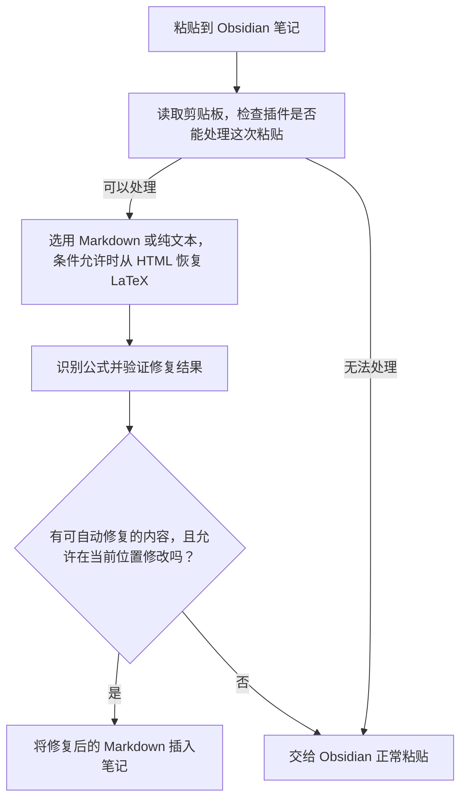

# Markdown Format Tool（格式工坊）

[English](README.md) · 简体中文

把 LaTeX 粘贴进 Obsidian 笔记，插件会自动修复可识别的公式格式。需要把内容发到微信或导出成 Word 时，可以用配套网页工具预览、整理和导出 Markdown。

## Obsidian 插件

### 安装插件

打开 [Obsidian 社区插件页面](https://community.obsidian.md/plugins/md-format-tool)，点击 **Add to Obsidian**。如果应用里的插件浏览器暂时搜不到，可以按下方步骤手动安装。插件需要 Obsidian 1.8.7 或更新版本。

**手动安装。** 从 [最新的 GitHub Release](https://github.com/ZGRX/md-format-tool/releases/latest) 下载 `main.js`、`manifest.json` 和 `styles.css`，把三个文件放进笔记库的 `.obsidian/plugins/md-format-tool/`，再到 **设置 → 第三方插件** 启用 **Markdown Format Tool**。

### 试一次粘贴

在 Obsidian 笔记里按 **⌘V** 或 **Ctrl+V**，粘贴下面这行：

```text
根为 \(x=\pm1\)。
```

插件会插入下面的 Markdown，Obsidian 会把它渲染成公式：

```markdown
根为 $x=\pm1$。
```

### 用命令面板检查修复

- **粘贴并修复 Markdown** 打开粘贴窗口、检查修复，然后将内容插入光标处或替换选区。
- **修复选区或当前笔记** 检查选区。没有选区时检查整篇当前笔记，疑似公式可逐项勾选。

命令名称随 Obsidian 的中英文语言设置切换，转换在本机完成。

## 运行配套网页工具

需要满足 [Vite 的 Node.js 版本要求](https://vite.dev/guide/)。

```sh
npm ci
npm run dev
```

打开终端显示的本机地址，默认是 [http://127.0.0.1:5173/](http://127.0.0.1:5173/)。

Word 导出还需要 [Pandoc](https://pandoc.org/installing.html)，支持从 PATH、项目下的 `.tools/pandoc-*/bin/pandoc` 或环境变量 `PANDOC_PATH` 查找。

### 导出选项

- **原文与修复。** 页面内置一篇重建的线性代数示例，预先勾选 7 处示例修复，变量 `(n)` 留待确认。新导入的括号候选需要手动勾选，明确的 LaTeX 分隔符会直接统一。可查看导入时的原始文字或 HTML，也可以恢复导入时的编辑内容。
- **微信分享。** 可复制段落、列表和表格的聊天文字。标准 PNG 宽 1040 像素，宽版 PNG 宽 1440 像素。多页打包为 ZIP。长表格按行分段并重复表头，超宽内容会缩放。
- **Word 文档。** 默认导出 Word 标题样式、原生表格和 OMML 公式。公式选项支持转图片或在 KaTeX 报错的位置保留源码。同一份内容通过本机 HTTP 接口交给 Pandoc，生成文件后直接返回浏览器。
- **Markdown 笔记。** 提供渲染预览和源码预览，可复制或下载。导出使用 Obsidian 支持的美元分隔符和 Markdown 表格语法。

## 开发者指南

### 粘贴修复流程



插件在粘贴时自动应用明确的 LaTeX 修复。可通过命令面板检查疑似公式。

### 构建和测试 Obsidian 插件

发布流程使用 Node.js 22。从头下载源码并在本机构建，可以执行以下命令：

```sh
git clone https://github.com/ZGRX/md-format-tool.git
cd md-format-tool
npm ci
npm test
npm run build:obsidian
```

1. 从 `obsidian/dist/md-format-tool/` 复制 `main.js`、`manifest.json` 和 `styles.css` 到测试笔记库的 `.obsidian/plugins/md-format-tool/` 目录。
2. 在 **设置 → 第三方插件** 中启用 **Markdown Format Tool**。每次重新构建后，重新复制三个文件，再关闭并启用插件。
3. 把[上面的示例](#试一次粘贴)粘贴到测试笔记里。改过公式识别逻辑时，也试一下普通文字、代码块和已有公式的 Markdown，确认插件保留这些内容。

开发网页工具时，按上方步骤运行 `npm run dev`。用 `npm run build` 同时构建网页工具和插件，再用 `npm run preview` 预览构建后的网页。预览里的 Word 导出仍使用本机 Pandoc。

### 从哪里改代码

| 文件 | 用途 |
| --- | --- |
| [`obsidian/main.ts`](obsidian/main.ts) | 接收 Obsidian 粘贴事件、注册命令，并把修复结果写回编辑器。 |
| [`obsidian/paste.ts`](obsidian/paste.ts) | 选择剪贴板内容，并决定粘贴时自动应用哪些修复。 |
| [`src/format.ts`](src/format.ts) 和 [`src/import-html.ts`](src/import-html.ts) | 识别公式、将富文本 HTML 转成 Markdown。插件和网页工具共用这两个模块。 |
| [`src/app.tsx`](src/app.tsx) 和 [`src/export.ts`](src/export.ts) | 实现网页界面和导出功能。 |
| [`tests/format.test.ts`](tests/format.test.ts) | 测试公式识别、粘贴修复，以及哪些 Markdown 应原样保留。 |

提交粘贴问题时，请附上来源应用、可分享的最小示例、实际输出和期望的 Markdown。修复公式识别或粘贴行为时，把复现示例加到回归测试里，再运行 `npm test`。

## 首版范围

- HTML 公式恢复依赖剪贴板中的 LaTeX 注解或 `data-latex`、`data-tex`。网页复杂嵌入和附件目录的兼容性有限。预览和导出图片仅载入可识别的内嵌位图。其他图片显示占位文字，Markdown 保留原有地址。
- 浏览器中的 Word 预览用于检查内容与结构，实际分页由 Word 渲染。已检查示例 DOCX 内的 8 个 OMML 公式、3 个方框和原生表格。Microsoft Word、WPS、Obsidian 客户端和手机微信仍需人工验收。
- 首版默认监听回环地址，HTML 解析、公式识别和图片生成在浏览器内完成，Word 转换在本机运行。

## 许可证

项目采用 [MIT 许可证](LICENSE)。插件构建产物内附第三方许可证声明。
